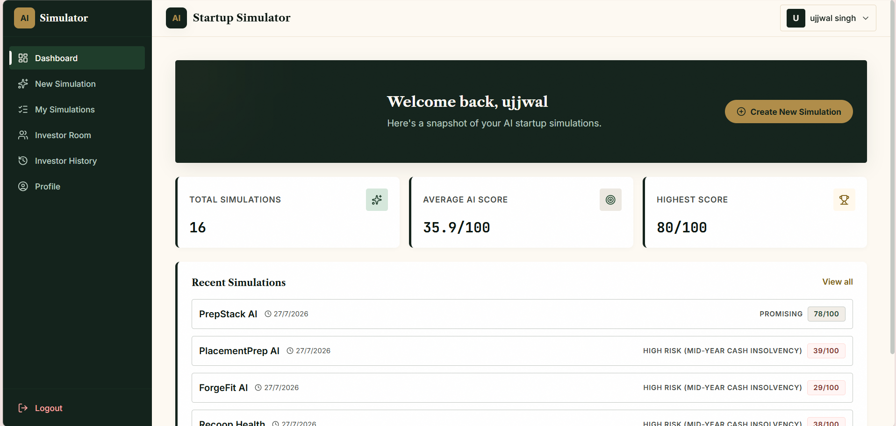
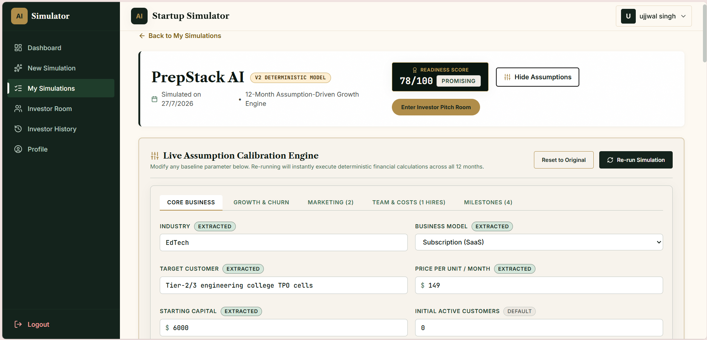
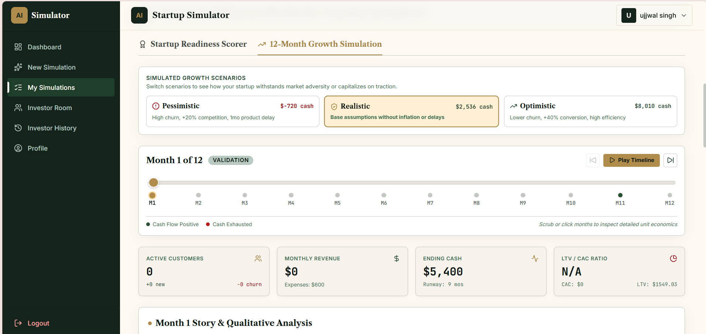
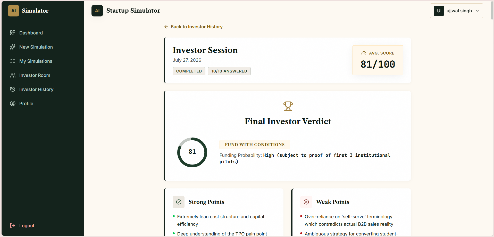
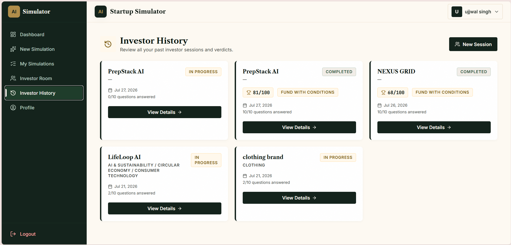

# AI Startup Simulator
*An enterprise-grade SaaS platform for deterministic startup simulation, algorithmic financial modeling, and structured venture capital readiness evaluation.*

[](https://opensource.org/licenses/MIT)
[](https://react.dev/)
[](https://nodejs.org/)
[](https://www.mongodb.com/)
[](https://ai.google.dev/)

---

## Framing Statement

> **"AI is the engine — this is the product built around it."**

Unlike simple LLM wrappers that rely on unverified qualitative text generation, **AI Startup Simulator** embeds Google Gemini within a rigorous, deterministic financial engine. The core product orchestrates a canonical 12-month simulation that independently models logarithmic marketing diminishing returns, time-delayed acquisition ramp-up curves, margin-adjusted Lifetime Value (LTV), and fully-loaded Customer Acquisition Cost (CAC) accounting for sales headcount overhead. Qualitative AI analysis is strictly schema-enforced and structured across a 100-point, 7-dimension readiness evaluation matrix, backed by automated stress-testing scenarios, idempotency-protected background job processing, and persistent interactive due diligence histories.

---

## Visual Walkthrough

A visual overview of the core entrepreneurial workflow, from assumption intake and financial simulation to interactive due diligence defense.

| Landing & Onboarding | Executive Dashboard |
| :---: | :---: |
| <br><sup>*Stateless HTTP-only cookie JWT authentication and secure user onboarding.*</sup> | <br><sup>*Executive overview of startup portfolios, aggregate metrics, and session histories.*</sup> |

| Assumption Intake | 12-Month Financial Projections |
| :---: | :---: |
| <br><sup>*Structured assumption intake with automated natural-language hypothesis extraction.*</sup> | <br><sup>*Interactive 365-day revenue/cash flow trajectories and 7-dimension evaluation.*</sup> |

| Interactive VC Defense Room | Institutional Investment Memo |
| :---: | :---: |
| <br><sup>*Live 10-question venture capital due diligence interrogation and real-time answer scoring.*</sup> | <br><sup>*Final institutional memo detailing critical risks, strong points, and funding probability.*</sup> |

---

## Key Features

### 📈 Deterministic Simulation Engine (`simulationEngine.js`, `marketingChannels.js`)
* **12-Month Algorithmic Financial Projections:** Simulates month-by-month cash flow, customer acquisition, churn attrition, operational burn rate, and runway exhaustion across a full 365-day operating cycle.
* **Logarithmic Marketing Diminishing Returns:** Calculates lead generation across 6 distinct channel archetypes (*Paid Ads, Organic Search, Social Media, Referral, Partnerships, Direct Sales*) using logarithmic saturation multipliers and time-delayed ramp-up curves (`min(1.0, month / rampUpMonths)`).
* **Margin-Adjusted LTV & Fully-Loaded CAC:** Computes Lifetime Value accounting for variable hosting infrastructure and payment processing fees (e.g., Stripe 2.9% + $0.30/tx). Distinguishes marketing-only CAC from fully-loaded CAC by incorporating cumulative sales and marketing headcount salaries from structured hiring plans.

### 🏆 Structured Evaluation & Scoring Architecture (`scoringEngine.js`)
* **7-Dimension Readiness Scorecard:** Evaluates simulation outcomes against a deterministic 100-point rubric:
  1. *Market Opportunity* (15 pts) — Analyzes geographic scale, industry expansion, and initial capitalization.
  2. *Customer Problem Strength* (15 pts) — Evaluates retention stickiness and willingness-to-pay thresholds.
  3. *Customer Traction* (15 pts) — Tracks net user growth trajectories while penalizing high churn volume.
  4. *Business Model* (15 pts) — Assesses cumulative revenue scale and recurring subscription predictability.
  5. *Unit Economics* (15 pts) — Benchmarks LTV:CAC ratios against industry standards (rewarding ratios >= 3:1).
  6. *Financial Sustainability* (15 pts) — Monitors cash exhaustion timelines, break-even milestones, and runway health.
  7. *Competition & Differentiation* (10 pts) — Measures competitive pressure factors and target niche defensibility.
* **Solvency Penalties & Survival Classification:** Automatically overrides qualitative scores upon detecting mid-year cash insolvency, assigning strict diagnostic classifications (e.g., *High Risk — Immediate Cash Insolvency*, *Promising Idea — Unfunded Plan*, *Exceptional Simulation Result*).
* **Automated Multi-Scenario Stress Testing (`scenarioModifiers.config.js`):** Automatically generates and evaluates 3 distinct operating environments simultaneously: *Realistic* (1.0x baseline), *Pessimistic* (-40% conversion, +50% churn, +15% cost inflation), and *Optimistic* (+40% conversion, -40% churn, -5% costs).

### 💼 Venture Capital Investor Simulation (`investor.service.js`, `investor.controller.js`)
* **Interactive Due Diligence Defense (`/api/v2/investor/start`):** Analyzes the startup's specific simulation weaknesses and generates a custom 10-question venture capital interrogation designed to test executive readiness.
* **Real-Time Answer Evaluation (`/api/v2/investor/answer`):** Evaluates entrepreneur responses on a per-question basis, providing numeric scoring, constructive feedback on weaknesses, and strategic coaching notes.
* **Institutional Investment Memos:** Synthesizes the completed pitch defense into an executive investment memo featuring an institutional funding decision, primary risk factors, core defensibility points, and a calculated probability of funding.

### ⚡ Enterprise Infrastructure & Session Management (`simulation.controller.js`, `gemini.service.js`)
* **Asynchronous Execution & Idempotency (`/api/v2/simulations/run-async`, `/jobs/:jobId`):** Background job orchestration supporting idempotent request headers (`Idempotency-Key`) and non-blocking polling for intensive simulation workloads.
* **AI Assumption Extraction (`/api/v2/simulations/extract`):** Transforms unstructured natural-language business descriptions into structured, schema-compliant financial assumptions (pricing, churn, initial capital, marketing budgets) prior to simulation execution.
* **Resilient Multi-Model Fallback Hierarchy:** Integrates Google GenAI (`@google/genai`) with an automated fallback matrix (`gemini-3.1-flash-lite-preview` ➔ `gemini-2.5-flash` ➔ `gemini-2.0-flash` ➔ `gemini-1.5-pro`), complete with boot-time API model verification (`verifyModelAtBoot`).
* **Schema-Enforced JSON Parsing (`aiJsonParser.js`):** Guarantees type safety by validating all generative AI outputs against strict schema requirements before committing data to application state.

### 🔐 Authentication & Security Architecture (`auth.controller.js`, `auth.middleware.js`)
* **Stateless HTTP-Only Cookie Authentication:** Delivers JSON Web Tokens via secure, HTTP-only cookies to eliminate Cross-Site Scripting (XSS) token interception risks.
* **Protected Middleware & Specialized Rate Limiting:** Safeguards API endpoints with tiered rate limiters (`rateLimiter`, `aiRateLimiter`), throttling high-cost generative AI requests to prevent quota exhaustion and denial-of-service vectors.

---

## What Makes This a Product, Not a Wrapper

A foundational criticism of AI-enabled software is the tendency to build "thin wrappers" around LLM APIs—applications where the AI model performs the core domain logic in an opaque, unverified manner. **AI Startup Simulator** architecturally solves this through strict separation of concerns and deterministic domain modeling:

```
+-----------------------------------------------------------------------------------+
|                              AI STARTUP SIMULATOR                                 |
+-----------------------------------------------------------------------------------+
|                                                                                   |
|  +-------------------------------------+   +-----------------------------------+  |
|  |     DETERMINISTIC PRODUCT LOGIC     |   |     GENERATIVE AI SERVICE LAYER   |  |
|  |  (JavaScript Math & Scoring Engine) |   |    (Google GenAI SDK Integration) |  |
|  +-------------------------------------+   +-----------------------------------+  |
|  | • Logarithmic Marketing Returns     |   | • Unstructured Concept Extraction |  |
|  | • Margin-Adjusted LTV Calculation   |   | • Qualitative SWOT Synthesis      |  |
|  | • Fully-Loaded CAC (w/ Salaries)    |   | • VC Due Diligence Interrogation  |  |
|  | • 100-Point 7-Dimension Scorecard   |   | • Pitch Answer Coaching & Scoring |  |
|  | • Solvency & Cash Runway Tracking   |   | • Institutional Memo Formatting   |  |
|  | • Multi-Scenario Stress Testing     |   | • Strict Schema-Enforced JSON     |  |
|  +-------------------------------------+   +-----------------------------------+  |
|                     │                                        │                    |
+---------------------┼----------------------------------------┼--------------------+
                      ▼                                        ▼
    [ Verifiable Financial Projections ]     [ Contextual Strategic Analysis ]
```

1. **Zero Financial Delegation to LLMs:** Compound mathematical modeling over time (runway burn, CAC saturation, LTV ratios, and user churn compounding) cannot be reliably executed by LLMs. In this product, **100% of financial projections and quantitative scoring are executed by standalone deterministic JavaScript engines** (`simulationEngine.js`, `scoringEngine.js`). The AI is relegated exclusively to natural language synthesis and contextual reasoning.
2. **Standardized, Verifiable Evaluation Dimensions:** Rather than prompting an LLM to subjectively rate a startup idea, the application evaluates 7 distinct quantitative dimensions against rigid business logic rules (e.g., LTV:CAC ratios $< 1.0$ explicitly trigger unit economic failure penalties regardless of AI sentiment).
3. **Formal Specification-Driven Math Engine:** Simulation rules are governed by a canonical mathematical specification (`backend/documentation/engine_math_spec.md`), ensuring that channel ramp-up curves and hiring overhead calculations remain auditable and verifiable across test suites.
4. **Production SaaS Resiliency:** Unlike script demos, the platform features asynchronous job polling for long-running simulations, idempotency keys to prevent duplicate billing or processing, multi-tiered AI model fallbacks, and strict JSON schema parsers that reject malformed LLM responses.

---

## Architecture

The system follows a decoupled SaaS architecture separating a Vite-powered React single-page application from an Express API gateway, deterministic calculation engines, and MongoDB persistence.

```
       +-----------------------------------------------------------------+
       |                      FRONTEND CLIENT LAYER                      |
       |     React 19 • Vite 8 • Tailwind CSS 4 • Framer Motion          |
       +-----------------------------------------------------------------+
                                        │
                                        │  HTTPS / REST API (Axios w/ HTTP-Only Cookies)
                                        ▼
       +-----------------------------------------------------------------+
       |                      API GATEWAY & ROUTING                      |
       |       Express 4 • Rate Limiter • JWT Cookie Auth Middleware     |
       +-----------------------------------------------------------------+
                                        │
                 +----------------------+----------------------+
                 │                                             │
                 ▼                                             ▼
+---------------------------------+           +---------------------------------+
|   CONTROLLER & SERVICE LAYER    |           |   DETERMINISTIC MATH & SCORING  |
|  • Simulation Orchestration     |           |  • 12-Month Simulation Engine   |
|  • Async Job Polling & Idempot. |           |  • Logarithmic Lead Gen Math    |
|  • Investor Due Diligence State |           |  • 100-Pt 7-Dimension Scorecard |
+---------------------------------+           +---------------------------------+
                 │                                             │
                 +----------------------+----------------------+
                                        │
                 +----------------------+----------------------+
                 │                                             │
                 ▼                                             ▼
+---------------------------------+           +---------------------------------+
|     AI INTEGRATION SERVICE      |           |     PERSISTENCE & ODM LAYER     |
|  • Google GenAI SDK (^2.12.0)   |           |  • MongoDB Database             |
|  • Automated Model Fallback     |           |  • Mongoose 8 Schema ODM        |
|  • JSON Schema Enforcement      |           |  • Users, Simulations, Sessions |
+---------------------------------+           +---------------------------------+
```

### Component & Data Flow Summary
1. **Request Ingestion & Auth:** Client requests arrive via `/api/v2/*` endpoints, passing through security headers, CORS, rate limiters, and `protect` middleware which verifies stateless JWTs in HTTP-only cookies against Mongoose User schemas.
2. **Simulation Execution:** When initiating a simulation, `simulation.controller.js` invokes `simulationEngine.js` to run the 12-month deterministic cash flow and marketing saturation math. Once calculated, `scoringEngine.js` evaluates the quantitative output across the 7 business dimensions.
3. **AI Contextual Synthesis:** The calculated metrics and quantitative scores are formatted into structured prompts (`prompts/investor.prompt.js`) and transmitted to `gemini.service.js`, which manages model fallbacks and returns structured JSON evaluations verified by `aiJsonParser.js`.
4. **Persistence & State:** Final simulation reports, stress-test scenario variants, and interactive investor QA sessions are committed to MongoDB via Mongoose models (`Simulation`, `InvestorSession`, `SimulationJob`).

---

## Tech Stack

The application is built on a modernized MERN stack, utilizing the latest major releases across frontend and backend ecosystems.

| Layer | Technology | Version | Purpose & Implementation |
| :--- | :--- | :--- | :--- |
| **Frontend Framework** | [React](https://react.dev/) | `^19.2.7` | Component-driven UI architecture leveraging React 19 hooks and state primitives. |
| **Build Tooling** | [Vite](https://vitejs.dev/) | `^8.1.1` | Ultra-fast development server, module bundler, and production asset optimization. |
| **Styling & Design** | [Tailwind CSS](https://tailwindcss.com/) | `^4.3.3` | Utility-first styling with Vite integration (`@tailwindcss/vite`) and custom tokens. |
| **UI Animations** | [Framer Motion](https://www.framer.com/motion/) | `^12.42.2` | Fluid micro-animations, layout transitions, and interactive component feedback. |
| **Data Visualization** | [Recharts](https://recharts.org/) | `^3.10.0` | Declarative financial charting for 12-month revenue, runway, and unit economic trends. |
| **HTTP Client & Routing** | [Axios](https://axios-http.com/) / [React Router](https://reactrouter.com/) | `^1.18.1` / `^7.18.1` | Cookie-credentialed API communication and declarative client-side route management. |
| **Backend Runtime** | [Node.js](https://nodejs.org/) / [Express](https://expressjs.com/) | `^4.19.2` | High-performance asynchronous REST API gateway and request lifecycle orchestration. |
| **Database & ODM** | [MongoDB](https://www.mongodb.com/) / [Mongoose](https://mongoosejs.com/) | `^8.4.1` | Document-oriented persistence featuring schema validation and relational referencing. |
| **AI Integration** | [Google GenAI SDK](https://ai.google.dev/) | `^2.12.0` | Official GenAI SDK integrating Gemini 3.1 Flash-Lite Preview and multi-model fallbacks. |
| **Security & Auth** | [JSON Web Token](https://jwt.io/) / [Bcrypt.js](https://github.com/dcodeIO/bcrypt.js) | `^9.0.3` / `^3.0.3` | Cryptographic password hashing and stateless HTTP-only cookie token signing. |

---

## Getting Started

Follow these instructions to configure, install, and execute the application locally.

### Prerequisites
* **Node.js**: v18.0.0 or higher
* **npm**: v9.0.0 or higher
* **MongoDB**: Local MongoDB server running on port `27017` or an active MongoDB Atlas cluster URI
* **Google Gemini API Key**: Obtainable via [Google AI Studio](https://aistudio.google.com/)

### 1. Clone the Repository
```bash
git clone https://github.com/ujjwalkumar1here/ai-startup-simulator.git
cd ai-startup-simulator
```

### 2. Configure Backend Environment
Navigate to the `backend` directory, install dependencies, and initialize the environment variables:
```bash
cd backend
npm install
cp .env.example .env
```
Edit `backend/.env` and populate the required variables (see variable references below).

### 3. Configure Frontend Environment
In a new terminal window, navigate to the `frontend` directory, install dependencies, and initialize environment variables:
```bash
cd ../frontend
npm install
cp .env.example .env
```
Edit `frontend/.env` and ensure the API target points to your local backend server.

### 4. Required Environment Variables
> [!IMPORTANT]
> Never commit `.env` files containing live secret keys or database credentials to version control.

#### Backend (`backend/.env`)
| Variable Name | Description | Example Format |
| :--- | :--- | :--- |
| `PORT` | Port number for the Express API server | `5000` |
| `MONGODB_URI` | Connection string for MongoDB database | `mongodb://localhost:27017/ai-startup-simulator` |
| `JWT_SECRET` | Cryptographic secret for signing HTTP-only auth cookies | `string (min 32 random characters)` |
| `GEMINI_API_KEY` | Official API key from Google AI Studio | `AIzaSy...` |
| `GEMINI_MODEL` | Primary Gemini model identifier | `gemini-3.1-flash-lite-preview` |
| `NODE_ENV` | Runtime environment mode (`development` or `production`) | `development` |

#### Frontend (`frontend/.env`)
| Variable Name | Description | Example Format |
| :--- | :--- | :--- |
| `VITE_API_URL` | Base URL endpoint for backend REST API | `http://localhost:5000/api` |

### 5. Launch Development Servers

#### Start the Backend API Server
From within the `backend/` directory:
```bash
npm run dev
```
*The backend server will initiate boot verification for the configured Gemini model and bind to `http://localhost:5000`.*

#### Start the Frontend Vite Server
From within the `frontend/` directory:
```bash
npm run dev
```
*The client application will compile and become accessible at `http://localhost:5173`.*

---

## Project Structure

An annotated overview of the repository's core architectural hierarchy.

```
ai-startup-simulator/
├── backend/
│   ├── documentation/      # Canonical mathematical specifications (engine_math_spec.md)
│   ├── src/
│   │   ├── config/         # Environment variables & scenario modifier configurations
│   │   ├── controllers/    # Route controllers (auth, simulation, investor, health)
│   │   ├── database/       # MongoDB connection lifecycle management
│   │   ├── engine/         # Deterministic math, marketing channels & 100-pt scoring engine
│   │   ├── middleware/     # JWT cookie auth, rate limiting, error & API versioning
│   │   ├── models/         # Mongoose schemas (User, Simulation, InvestorSession, Job)
│   │   ├── prompts/        # Structured LLM prompt templates & system instructions
│   │   ├── routes/         # REST API endpoints (/auth, /simulations, /investor, /health)
│   │   ├── services/       # Business logic, Gemini AI fallback orchestration & benchmarks
│   │   ├── utils/          # Schema parsers, JWT helpers, error classes & async wrappers
│   │   └── validators/     # Request payload validation rules and sanitization
│   ├── .env.example        # Backend environment template
│   └── package.json        # Backend dependencies and server scripts
├── docs/
│   └── screenshots/        # Application UI walkthrough imagery
├── frontend/
│   ├── public/             # Static web assets and icons
│   ├── src/
│   │   ├── assets/         # Frontend styling and image resources
│   │   ├── components/     # Reusable UI components (navigation, charts, modals)
│   │   ├── context/        # Global React state management (AuthContext)
│   │   ├── pages/          # Application screens (Dashboard, Room, NewSim, Profile, etc.)
│   │   ├── services/       # API integration layer (authService, etc.)
│   │   ├── App.jsx         # Root application component & routing hierarchy
│   │   ├── index.css       # Global Tailwind CSS style definitions
│   │   └── main.jsx        # React DOM entry point
│   ├── .env.example        # Frontend environment template
│   ├── package.json        # Frontend dependencies and Vite configuration
│   └── vite.config.js      # Vite bundler setup and plugin configuration
└── README.md               # Product documentation & technical specifications
```

---

## Roadmap & Future Scope

Guided by institutional feedback and ongoing architectural refinement, planned enhancements include:

* **Exportable Institutional Investment Memos:** Generating standardized PDF reports synthesizing 12-month financial trajectories, SWOT matrices, and VC defense transcripts for offline stakeholder review.
* **Multi-Idea Side-by-Side Comparison Matrix:** Extending simulation analytics to support cross-prompt numeric benchmarking between alternative startup models under identical market assumptions.
* **Configurable VC Investor Personas:** Introducing specialized AI due diligence personas (e.g., *Aggressive Growth VC*, *Conservative Angel Investor*, *Bootstrapped Revenue-First Fund*) with tailored risk tolerances and hurdle rates.

---

## License & Acknowledgements

* **Defense & Demonstration:** Designed and developed as a comprehensive MERN stack capstone software engineering project for institutional defense and faculty panel evaluation.
* **License:** Distributed under the MIT License. See `LICENSE` for information.
